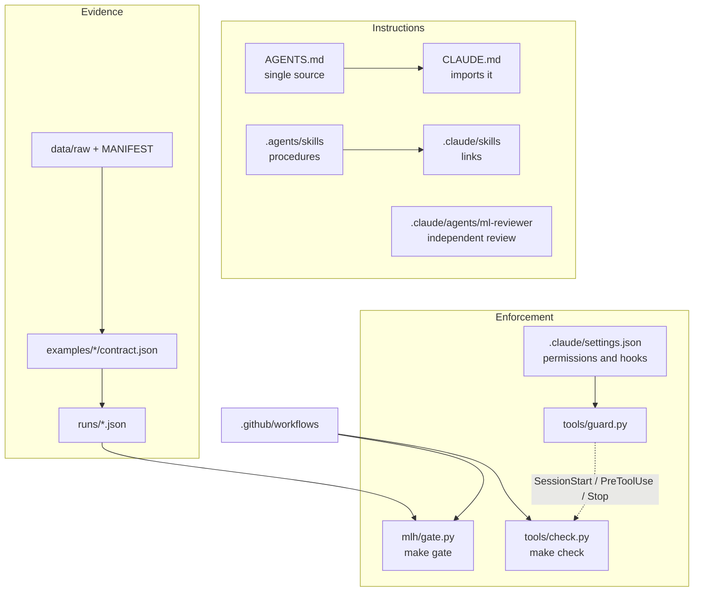

# Harness guide: what each piece does and how to adapt it

A harness is everything around the model that makes an agent (and a person) work the right way by default: the
instructions it reads, the skills it follows, the hooks that stop mistakes, the checks that prove consistency and the CI
that repeats them.

## 1. Instructions: one source for every agent

- **AGENTS.md** is the map and the rules. Codex reads it natively; Claude Code reads it through `@AGENTS.md` in
  CLAUDE.md. Keep it short (under 200 lines, checked by `make check`) and push detail into docs and skills.
- **Skills** in `.agents/skills/<name>/SKILL.md` are procedures with a `name` and a `description` that tells the agent
  when to use them. `.claude/skills/` holds links only (`make sync`).
- **Subagents** in `.claude/agents/` run with a clean context. `ml-reviewer` reviews without editing.

## 2. Enforcement: what the machine checks

| Piece | When it runs | What it does |
|---|---|---|
| Permissions in `.claude/settings.json` | Every tool call | Deny reading secret files, ask before `git push`, allow the safe `make` targets |
| `tools/guard.py` on SessionStart | When a session starts | Adds an orientation and remembers existing `make check` problems |
| `tools/guard.py` on PreToolUse | Before edits, reads and shell commands | Denies changes to raw data, hand edits to run records and the manifest, secrets, commits to main and `--no-verify` |
| `tools/guard.py` on Stop | When the agent wants to finish | Sends it back once if the session introduced new `make check` problems |
| `tools/check.py` | `make check`, CI, the guard | Manifest, contracts, run records, skills, subagents, settings, instructions, links, secrets |
| `mlh/gate.py` | `make gate`, CI | Six promotion rules on a run record |

A guard that crashes lets the call through: enforcement must never block work because of its own bug. Tests cover the
guard (`tests/test_guard.py`).

## 3. Evidence: contracts, raw data and run records

`data/raw/` is append-only and hashed. Contracts describe each task. Run records tie every result to the exact data,
code and contract. The gate rereads all three hashes before trusting a record.

## 4. CI

Two workflows, both on pull requests only:

- **harness** (`ubuntu-slim`, standard library): `make check` and the tests that need no dependencies. Cheap; always runs.
- **ml** (`ubuntu-latest`): only when code, data, contracts, tests or dependencies change. Installs the pinned
  dependencies, runs every test, runs the demo into a scratch run folder and asserts that the honest model passes the
  gate and the leaky one fails.

Both cancel superseded runs on the same branch. Public repositories do not pay for standard GitHub-hosted runners;
private ones do, so the same rules keep the bill small.

## 5. Adapt it to your project

1. Use this repository as a template, or copy `mlh/`, `tools/`, `.agents/`, `.claude/`, `AGENTS.md`, `CLAUDE.md`,
   `Makefile` and `.github/`.
2. Put your raw files in `data/raw/` and run `make manifest`.
3. Write your contract with the data-contract skill (`examples/<task>/contract.json`). Agree the gate thresholds with
   the owner of the decision before running anything.
4. Copy `examples/weekly_risk/run.py` as a starting point: keep the order (baselines, past-only features, choose on
   validation, confirm once on test, record).
5. Edit AGENTS.md: the map, any project rule, the commands. Remove the examples you do not need.
6. Add project-specific guard rules in `tools/guard.py` with a test in `tests/test_guard.py`.
7. Open a pull request: CI runs the checks and the gate.

## 6. Codex and other agents

AGENTS.md and `.agents/skills/` are read by Codex. The Claude Code hooks do not run there: rely on `make check` and CI,
or configure equivalent hooks for that tool.
