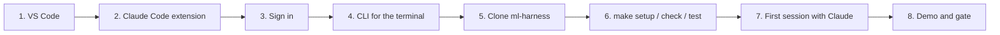

# Install Claude Code in VS Code and open this harness

A step-by-step guide for someone who has never used Claude Code. About 15 minutes.

> Checked against the official documentation on 9 Nov 2026. The extension changes often; when a screen looks
> different, the [VS Code page of the docs](https://code.claude.com/docs/en/vs-code) wins.



## 1. Before you start

| You need | Notes |
|---|---|
| VS Code, recent | The Marketplace page lists 1.98 or later. Cursor and other VS Code forks also work ([docs](https://code.claude.com/docs/en/vs-code)) |
| A Claude account with Claude Code | Pro, Max, Team or Enterprise plans, or a Claude Console account. The free plan does not include it. Companies can also use Amazon Bedrock, Google Cloud or Microsoft Foundry ([setup](https://code.claude.com/docs/en/setup)) |
| Git, make and Python 3.12 | On Windows, use WSL or install Git for Windows |
| A machine that runs Claude Code | macOS 13+, Windows 10 1809+, Ubuntu 20.04+ or Debian 10+, 4 GB of RAM or more ([setup](https://code.claude.com/docs/en/setup)) |

## 2. Install the extension

1. Open VS Code and the Extensions view: `Cmd+Shift+X` (macOS) or `Ctrl+Shift+X` (Windows/Linux).
2. Search for **Claude Code**. The extension is **Claude Code for VS Code**, published by **Anthropic**.
3. Click **Install**.

From a terminal, the same thing: `code --install-extension anthropic.claude-code`.

```
┌ Extensions ───────────────────────────┐
│ 🔍 Claude Code                        │
│ ┌───────────────────────────────────┐ │
│ │ ✳ Claude Code for VS Code         │ │
│ │   Anthropic            [Install]  │ │
│ └───────────────────────────────────┘ │
└───────────────────────────────────────┘
```

## 3. Sign in

1. Open the Claude panel: the **spark icon** in the editor toolbar (visible when a file is open) or in the Activity Bar.
   You can also use the Command Palette (`Cmd/Ctrl+Shift+P`) and type **Claude Code: Open in New Tab**.
2. Click **Sign in** and authorize in the browser that opens.
3. A "Learn Claude Code" checklist appears in the panel. You are ready.

## 4. Install the CLI too (for the terminal and for hooks)

The extension carries its own copy of Claude Code for the panel, but it does not put the `claude` command on your PATH.
Install the CLI to use Claude Code in the terminal ([setup](https://code.claude.com/docs/en/setup)):

| System | Command |
|---|---|
| macOS, Linux, WSL | `curl -fsSL https://claude.ai/install.sh \| bash` |
| Windows PowerShell | `irm https://claude.ai/install.ps1 \| iex` |
| Homebrew | `brew install --cask claude-code` |
| WinGet | `winget install Anthropic.ClaudeCode` |

Check it with `claude --version` and `claude doctor`. The native installer updates itself; Homebrew and WinGet do not.

## 5. Clone the harness and open it

```sh
git clone https://github.com/coagente/ml-harness.git
cd ml-harness
code .
```

When VS Code asks whether you trust the authors of the folder, read [AGENTS.md](../AGENTS.md) and
[.claude/settings.json](../.claude/settings.json) first: the hooks run `tools/guard.py` on your machine.

## 6. Prepare and verify

```sh
make setup     # .venv with the pinned dependencies
make check     # harness and evidence checks; expect "All checks passed."
make test      # unit tests
```

## 7. Your first session with Claude

In the Claude panel:

| You do | What happens |
|---|---|
| Type `Read AGENTS.md and explain this harness to me in five bullets` | The SessionStart hook has already added an orientation; Claude reads the map |
| Type `@examples/weekly_risk/contract.json what decision does this contract support?` | `@` adds a file or folder as context; selected text is sent automatically, and `Option+K` / `Alt+K` inserts a reference with line numbers |
| Ask `Run make demo and then make gate on the new run record` | Claude proposes commands; the allow list in settings lets these run |
| Ask it to edit `data/raw/weekly_events.csv` | The guard denies it and explains why: raw data is immutable |
| Type `/leakage-review` | Runs the skill from `.agents/skills/` |
| Ask `Use the ml-reviewer subagent to review my branch` | An independent reviewer with a clean context reports findings and never edits |

**Permission modes**, from the mode indicator under the prompt box: **Manual** (asks before edits and commands; the
default), **Edit automatically**, **Plan** (proposes a plan before touching anything) and **Auto**. Start with Manual or
Plan. Proposed edits appear as side-by-side diffs with Accept and Reject buttons. In the terminal CLI, `Shift+Tab`
cycles the modes ([permission modes](https://code.claude.com/docs/en/permission-modes)).

Useful shortcuts: `Cmd/Ctrl+Esc` moves the focus between the editor and Claude; `Cmd/Ctrl+Shift+Esc` opens Claude in a
new tab.

## 8. Run the demo and the gate

```sh
make demo          # a model that beats the best baseline: the gate says PASS
make demo-leak     # a leak on purpose: the gate says FAIL (contract rule)
make demo-small    # do you need a neural network with 16 rows?
```

Then read [docs/methodology.md](methodology.md) and, to start your own project from this template,
[docs/harness-guide.md](harness-guide.md#5-adapt-it-to-your-project).

## 9. Going further

- **In CI:** the official GitHub Action is `anthropics/claude-code-action@v1`; inside Claude Code, `/install-github-app`
  sets it up ([GitHub Actions](https://code.claude.com/docs/en/github-actions)).
- **Headless:** `claude -p "prompt"` runs a single task without the interactive UI ([headless](https://code.claude.com/docs/en/headless)).
- **Your own files:** `/init` writes a CLAUDE.md for a new project ([memory](https://code.claude.com/docs/en/memory));
  settings, hooks, skills and subagents are described in the [settings](https://code.claude.com/docs/en/settings),
  [hooks](https://code.claude.com/docs/en/hooks), [skills](https://code.claude.com/docs/en/skills) and
  [subagents](https://code.claude.com/docs/en/sub-agents) pages.
