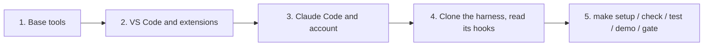

# Install the harness on macOS, Windows (WSL 2) or Linux, with Claude Code in VS Code

A step-by-step guide for someone who has never used Claude Code. At the end you have VS Code with the Claude Code
extension, the `claude` CLI signed in to your account, and this repository cloned and verified. About 30 to 60 minutes,
plus a restart on Windows.

> Checked against the official documentation on 10 Nov 2026 (sources at the end). The Linux, macOS and native-Windows
> commands are exercised by the [install workflow](../.github/workflows/install.yml) on GitHub-hosted runners. What CI
> cannot cover: `wsl --install`, the VS Code panel and signing in. When a screen looks different, the official docs win.



## 1. What you install and why

| Tool | What for | Required? |
|---|---|---|
| Git | Clone, branches and pull requests | Yes |
| Python 3.9 or later (`python3`) | The guard, `make check` and the gate; standard library only | Yes |
| make | `make setup`, `check`, `test`, `demo`, `gate` | Yes |
| uv | `make setup` uses it to build `.venv` with Python 3.12 and the pinned dependencies, downloading Python 3.12 if needed | Recommended. Without uv, `make setup` uses your `python3`, which must then be 3.12 |
| VS Code 1.94 or later | The editor | Yes |
| Claude Code extension (`anthropic.claude-code`) | The Claude panel in VS Code | Yes |
| Claude Code CLI (`claude`) | Claude in the terminal; the extension does not install it | Yes |
| Python extension (`ms-python.python`) | Python in VS Code | Recommended |
| WSL 2 and the WSL extension (`ms-vscode-remote.remote-wsl`) | Windows only: the Linux where the harness runs | Yes, on Windows |
| GitHub CLI (`gh`) | Pull requests from the terminal; `/install-github-app` needs it | Optional |
| Docker and Dev Containers (`ms-vscode-remote.remote-containers`) | An isolated container for the agent (§9) | Optional |

## 2. Before you start

- **A Claude account that includes Claude Code:** a Pro, Max, Ultra, Team or Enterprise plan, or a Claude Console
  account. The free plan does not include it. Companies can also use Amazon Bedrock, Google Cloud or Microsoft Foundry
  ([authentication](https://code.claude.com/docs/en/authentication)).
- **What leaves your machine.** On every surface, the VS Code panel and the terminal included, what Claude reads is sent
  to the model provider. On the web and in GitHub Actions, the repository is also cloned on Anthropic or GitHub
  infrastructure. Check with your company before using Claude Code on its code or data. This repository is public and
  its data is synthetic.
- **Administrator rights** to install programs and, on Windows, to run `wsl --install`.
- **Network.** The installers download from `claude.ai`, `downloads.claude.ai`, `github.com`, `astral.sh`, the VS Code
  Marketplace and your system's package repositories; `make setup` downloads numpy and scikit-learn from PyPI
  (`pypi.org`, `files.pythonhosted.org`).
  - **Behind a proxy:** Claude Code and uv read `HTTPS_PROXY`, and git and pip honor it too.
  - **Behind TLS inspection:** Claude Code works when the company root certificate is in the system store, or via
    `NODE_EXTRA_CA_CERTS`. uv uses its bundled roots by default; set `UV_SYSTEM_CERTS=true` to use the system store
    ([network configuration](https://code.claude.com/docs/en/network-config),
    [uv certificates](https://docs.astral.sh/uv/concepts/authentication/certificates/)).
- **System:** macOS 13 or later; Windows 10 version 2004 (build 19041) or later, or Windows 11; Ubuntu 22.04 or later,
  or Debian 12 or later; 4 GB of RAM. Claude Code also supports Ubuntu 20.04 and Debian 10, but their `python3` is
  older than 3.9, the oldest the guard is tested with.

## 3. macOS

In the Terminal app:

1. **Xcode command line tools** (git, make, python3). A window opens: accept, and wait for it to finish.
   ```sh
   xcode-select --install
   ```
2. **Homebrew** ([brew.sh](https://brew.sh)). At the end it prints "Next steps": run them to put `brew` on your PATH.
   ```sh
   /bin/bash -c "$(curl -fsSL https://raw.githubusercontent.com/Homebrew/install/HEAD/install.sh)"
   ```
3. **uv, GitHub CLI and VS Code.** The VS Code cask also installs the `code` command.
   ```sh
   brew install uv gh
   brew install --cask visual-studio-code
   ```
   If VS Code was already installed another way, run **Shell Command: Install 'code' and optionally 'copilot' commands
   in PATH** from the Command Palette (`Cmd+Shift+P`).
4. **Claude Code for the terminal.** Open a new terminal afterwards and check with `claude --version`.
   ```sh
   curl -fsSL https://claude.ai/install.sh | bash
   ```
   Alternative: `brew install --cask claude-code`, which does not update itself (`brew upgrade claude-code`).
5. **VS Code extensions.**
   ```sh
   code --install-extension anthropic.claude-code
   code --install-extension ms-python.python
   ```

Continue with §6.

## 4. Windows: the harness lives in WSL 2

On Windows, the harness runs inside Ubuntu on WSL 2. VS Code stays on Windows and connects through the WSL extension.

**Why WSL.** The harness hooks call `python3` and the harness uses `make`. Natively, Claude Code runs hooks in Git Bash
or PowerShell, where neither usually exists, so the guard would not run as designed. Claude Code itself works
natively (§4.3); the harness is not supported there.

### 4.1 On Windows, in PowerShell

1. **WSL 2 with Ubuntu.** Open PowerShell as administrator (right click, "Run as administrator"):
   ```powershell
   wsl --install
   ```
   Restart Windows. The first time Ubuntu opens, it asks for a Linux user name and password.
   - If the command only prints its help, WSL was already installed: `wsl --list --online`, then
     `wsl --install -d Ubuntu`.
   - If it hangs at 0.0%: `wsl --install --web-download -d Ubuntu`.
   - Check with `wsl -l -v`: VERSION must be 2. If it is 1, run `wsl --set-version Ubuntu 2`; on WSL 1, Claude Code can
     fail with `Exec format error`.
2. **VS Code and the WSL extension**, in a normal PowerShell:
   ```powershell
   winget install --id Microsoft.VisualStudioCode -e
   ```
   Open a new PowerShell, then:
   ```powershell
   code --install-extension ms-vscode-remote.remote-wsl
   ```

### 4.2 In Ubuntu (WSL)

Open "Ubuntu" from the Start menu, or type `wsl` in PowerShell.

3. **Base tools.**
   ```sh
   sudo apt update
   sudo apt install -y git make python3 python3-venv curl
   ```
4. **uv and Claude Code**, then open a new Ubuntu terminal.
   ```sh
   curl -LsSf https://astral.sh/uv/install.sh | sh
   curl -fsSL https://claude.ai/install.sh | bash
   ```
5. **The repository, on the Linux disk.** Keep it in `~/projects`, never under `/mnt/c/...`: for Linux tools,
   Microsoft recommends the Linux file system, which is faster.
   ```sh
   mkdir -p ~/projects && cd ~/projects
   git clone https://github.com/coagente/ml-harness.git
   cd ml-harness
   ```
   **Before opening it in VS Code, read `.claude/settings.json` and `tools/guard.py`** (why: §7):
   ```sh
   cat .claude/settings.json
   less tools/guard.py
   ```
   Then open it:
   ```sh
   code .
   ```
   The first time, VS Code installs its server inside Ubuntu. The window it opens is connected to WSL; the lower-left
   corner says so. VS Code asks whether you trust the authors of the folder: say yes only after reading those two
   files. With "No, I don't trust the authors", the folder opens in Restricted Mode and the Claude Code extension does
   not run.
6. **Extensions inside WSL.** In that window, open Extensions (`Ctrl+Shift+X`) and install **Claude Code** and
   **Python**; they install inside Ubuntu. That the Claude panel works in a WSL window is an inference: the extension
   declares `extensionKind: workspace` and publishes Linux builds, but the Claude Code docs do not mention remote WSL.
   If the panel does not respond, run `claude` in the integrated terminal (Terminal → New Terminal), which in that
   window is the Ubuntu terminal.

Continue with §6, in this same window.

### 4.3 Claude Code on Windows without WSL (Claude only, not the harness)

- PowerShell: `irm https://claude.ai/install.ps1 | iex`. CMD:
  `curl -fsSL https://claude.ai/install.cmd -o install.cmd && install.cmd && del install.cmd`. WinGet:
  `winget install Anthropic.ClaudeCode` (no self-update: `winget upgrade Anthropic.ClaudeCode`).
- Git for Windows (`winget install --id Git.Git -e`) is optional: with it, Claude uses Git Bash; without it,
  PowerShell.
- `'claude' is not recognized`: add `%USERPROFILE%\.local\bin` to your user PATH. `irm is not recognized`: you are in
  CMD, use the CMD command. `The token '&&' is not a valid statement separator`: you are in PowerShell, use the
  PowerShell command.

## 5. Linux (Ubuntu or Debian)

1. **Base tools.**
   ```sh
   sudo apt update
   sudo apt install -y git make python3 python3-venv curl
   ```
2. **uv.**
   ```sh
   curl -LsSf https://astral.sh/uv/install.sh | sh
   ```
3. **VS Code.** On Ubuntu, with snap:
   ```sh
   sudo snap install --classic code
   ```
   Debian has no snap: use the `.deb` from [code.visualstudio.com](https://code.visualstudio.com/docs/setup/linux)
   (`sudo apt install ./<file>.deb`), which offers to add Microsoft's repository for updates.
4. **Claude Code**, then open a new terminal and check with `claude --version`.
   ```sh
   curl -fsSL https://claude.ai/install.sh | bash
   ```
5. **VS Code extensions.**
   ```sh
   code --install-extension anthropic.claude-code
   code --install-extension ms-python.python
   ```

Fedora or RHEL (not tested): `sudo dnf install git make python3 curl`, and VS Code with dnf and Microsoft's repository
([steps](https://code.visualstudio.com/docs/setup/linux)); the rest is the same. Continue with §6.

## 6. VS Code and the Claude panel

1. **Open the panel:** the **spark icon** in the editor toolbar (visible when a file is open) or in the Activity Bar;
   **Claude Code** in the status bar; or the Command Palette: **Claude Code: Open in New Tab** or **Open in Side Bar**.
2. **Sign in** and authorize in the browser that opens. A "Learn Claude Code" checklist appears.
3. **Context:** `@file` or `@folder/` adds context; selected text is sent automatically, and `Option+K` / `Alt+K`
   inserts a reference with line numbers.
4. **Modes,** under the prompt box: **Manual** (asks before edits and commands), **Edit automatically**, **Plan**
   (proposes a plan before touching anything) and **Auto**. Start with Manual or Plan. In the terminal CLI, `Shift+Tab`
   cycles the modes ([permission modes](https://code.claude.com/docs/en/permission-modes)).
5. **Changes:** in Manual mode each edit is shown as a diff to accept or reject (**Accept this change** /
   **Reject this change**).
6. **Shortcuts:** `Cmd/Ctrl+Esc` moves the focus between the editor and Claude; `Cmd/Ctrl+Shift+Esc` opens Claude in a
   new tab.

The extension does not run in VS Code's Restricted Mode. It also works in Cursor.

**In the terminal:** `claude`, then `/login`; `/status` shows the version, model, account and connection; `/logout`
signs out. Credentials live in the macOS Keychain, in `~/.claude/.credentials.json` on Linux and in
`%USERPROFILE%\.claude\.credentials.json` on Windows; never in a repository. The native installer updates itself;
`claude update` updates by hand and `claude doctor` checks the installation.

## 7. Clone the harness and verify it

In the macOS or Linux terminal; on Windows, in Ubuntu. If you followed §4.2, you already cloned and read it: skip to
`make setup`.

```sh
mkdir -p ~/projects && cd ~/projects
git clone https://github.com/coagente/ml-harness.git
cd ml-harness
```

**Before opening Claude in the folder, read `.claude/settings.json` and `tools/guard.py`.** A hook is a program that
runs on your machine with your permissions.
- Trusting a folder, in VS Code's prompt or in Claude Code's trust dialog, lets its hooks run.
- Per the Claude Code docs, a project's hooks are used even without trusting that folder in two cases: when you trusted
  a parent folder such as `~/projects`, or when you run `claude -p`, which never shows the dialog
  ([what runs before you trust a folder](https://code.claude.com/docs/en/permissions#what-runs-before-you-trust-a-folder)).

Here the hooks only run `python3 -I tools/guard.py` at session start, before each tool and at the end. The rule holds
for any repository you clone.

```sh
make setup     # .venv with Python 3.12 and the pinned dependencies
make check     # "All checks passed."
make test      # "OK"
make demo      # weekly_risk: contract -> baselines -> models -> run record
make gate      # "PASS: the model moves to the next review..."
code .
```

**Test budget.** Every `make demo` spends one of the contract's three test evaluations, counted in the run-record
folder. After the third, the gate fails on purpose. To practice, use a fresh folder for each practice session and give
the gate the record from that folder:

```sh
export MLH_RUNS_DIR=$(mktemp -d)
make demo
make gate RUN=$(ls -t "$MLH_RUNS_DIR"/*.json | head -1)
```

## 8. Your first session with Claude

In the Claude panel:

| You do | What happens |
|---|---|
| Type `Read AGENTS.md and explain this harness to me in five bullets` | The SessionStart hook has already added an orientation; Claude reads the map |
| Type `@examples/weekly_risk/contract.json what decision does this contract support?` | `@` adds a file or folder as context |
| Ask `Run make demo and then make gate on the new run record` | Claude proposes commands; the allow list in settings lets these run |
| Ask it to edit `data/raw/weekly_events.csv` | The guard denies it and explains why: raw data is immutable |
| Type `/leakage-review` | Runs the skill from `.agents/skills/` |
| Ask `Use the ml-reviewer subagent to review my branch` | An independent reviewer with a clean context reports findings and never edits |
| Type `/hooks` or `/permissions` | Lists each hook and where it comes from; shows what is allowed, asked or denied |

Then:

```sh
make demo-leak     # a leak on purpose: the gate says FAIL (contract rule)
make demo-small    # do you need a neural network with 16 rows?
```

Read [docs/methodology.md](methodology.md) and, to start your own project from this template,
[docs/harness-guide.md](harness-guide.md#5-adapt-it-to-your-project).

## 9. Docker (optional): a container for the agent

- **What for.** A development container lets Claude work only with what is inside: the mounted repository and its tools.
  Anthropic's reference template starts an outbound firewall that only lets allowed domains through: its
  `devcontainer.json` runs `init-firewall.sh` in `postStartCommand`
  ([dev containers](https://code.claude.com/docs/en/devcontainer),
  [template](https://github.com/anthropics/claude-code/tree/main/.devcontainer)).
- **License.** Docker Desktop is free for small businesses (fewer than 250 employees and less than USD 10 million in
  annual revenue), personal use, education and non-commercial open source. Larger organizations need a paid
  subscription. Docker Engine's license is unchanged
  ([Docker Desktop license](https://docs.docker.com/subscription/desktop-license/)).
- **Install.** macOS: `brew install --cask docker-desktop`. Windows: `winget install --id Docker.DockerDesktop -e`,
  with WSL 2. Linux: Docker Engine from Docker's
  [apt repository](https://docs.docker.com/engine/install/ubuntu/), or the convenience script
  (`curl -fsSL https://get.docker.com -o get-docker.sh` and `sudo sh get-docker.sh`), which Docker does not recommend
  for production; check with `sudo docker run hello-world`. Using `docker` without `sudo` means joining the `docker`
  group, which grants root-level privileges ([post-install](https://docs.docker.com/engine/install/linux-postinstall/)).
- **In VS Code:** `code --install-extension ms-vscode-remote.remote-containers`, add the template and run
  **Dev Containers: Reopen in Container**.
- **Limits.** Inside the container, a malicious project can read whatever is there, including Claude's credentials: use
  trusted repositories only and do not mount `~/.ssh`. The docs allow `--dangerously-skip-permissions` in a container
  that does not run as root; an administrator can block it with `permissions.disableBypassPermissionsMode`.
- This repository does not ship a `.devcontainer` yet.

## 10. Troubleshooting

| Symptom | Likely cause | Fix |
|---|---|---|
| `command not found: claude` | `~/.local/bin` is not on your PATH | Open a new terminal; if it persists, add `export PATH="$HOME/.local/bin:$PATH"` to `~/.zshrc` or `~/.bashrc` |
| `code: command not found` (macOS) | VS Code did not add `code` to the PATH | Command Palette → **Shell Command: Install 'code' and optionally 'copilot' commands in PATH**; open a new terminal |
| `make: command not found` | Base tools are missing | macOS: `xcode-select --install`. Ubuntu or WSL: `sudo apt install -y make` |
| `make setup` fails with `ensurepip is not available` | `python3-venv` is missing and uv is not installed | Install uv (recommended) or `sudo apt install -y python3-venv` |
| `make setup` fails on network or certificates | Proxy or TLS inspection; uv uses its own roots | `export HTTPS_PROXY=...` and `export UV_SYSTEM_CERTS=true`; allow `pypi.org` and `files.pythonhosted.org` |
| The gate fails on "test budget" | Three test evaluations already spent in that run folder | Use a fresh folder: `export MLH_RUNS_DIR=$(mktemp -d)` and `make gate RUN=...` (§7) |
| `wsl --install` only prints its help | WSL was already installed | `wsl --list --online`, then `wsl --install -d Ubuntu` |
| `Exec format error` running `claude` in WSL | The distribution runs on WSL 1 | `wsl --set-version Ubuntu 2` |
| `exec: node: not found` or `/mnt/c/` paths in WSL | WSL is using Windows' Node or npm | Install the CLI with the native installer inside Ubuntu (§4.2), not with Windows npm |
| Everything is slow in WSL | The repository is under `/mnt/c/...` | Clone it again under `~/projects` |
| No spark icon | No file is open | Open a file, or use **Claude Code: Open in New Tab** |
| The panel does nothing | The folder is in Restricted Mode | Read the repository (§7) and trust the folder |
| Connection or certificate errors in Claude | Proxy or TLS inspection | `HTTPS_PROXY` and the root certificate ([network configuration](https://code.claude.com/docs/en/network-config)); `claude --debug` writes details to `~/.claude/debug/` |

More cases: [installation troubleshooting](https://code.claude.com/docs/en/troubleshoot-install).

## 11. Going further

- **In CI:** the official GitHub Action is `anthropics/claude-code-action@v1`; inside Claude Code, `/install-github-app`
  sets it up and stores `ANTHROPIC_API_KEY`, or `CLAUDE_CODE_OAUTH_TOKEN` from `claude setup-token`
  ([GitHub Actions](https://code.claude.com/docs/en/github-actions)).
- **Other surfaces on the same account:** the desktop app (Code tab), Claude Code on the web
  ([claude.ai/code](https://claude.ai/code)) and the JetBrains plugin.
- **Headless:** `claude -p "prompt"` runs a single task without the interactive UI
  ([headless](https://code.claude.com/docs/en/headless)).
- **Your own files:** `/init` writes a CLAUDE.md for a new project ([memory](https://code.claude.com/docs/en/memory));
  settings, hooks, skills and subagents are described in the [settings](https://code.claude.com/docs/en/settings),
  [hooks](https://code.claude.com/docs/en/hooks), [skills](https://code.claude.com/docs/en/skills) and
  [subagents](https://code.claude.com/docs/en/sub-agents) pages.

## Sources

Consulted on 10 Nov 2026: Claude Code docs ([setup](https://code.claude.com/docs/en/setup),
[troubleshooting](https://code.claude.com/docs/en/troubleshoot-install), [VS Code](https://code.claude.com/docs/en/vs-code),
[authentication](https://code.claude.com/docs/en/authentication), [permissions](https://code.claude.com/docs/en/permissions),
[network](https://code.claude.com/docs/en/network-config), [dev containers](https://code.claude.com/docs/en/devcontainer),
[GitHub Actions](https://code.claude.com/docs/en/github-actions)); the VS Code Marketplace manifest of
`anthropic.claude-code` (engine `^1.94.0`, `extensionKind: workspace`); Microsoft Learn
([Install WSL](https://learn.microsoft.com/en-us/windows/wsl/install),
[file systems](https://learn.microsoft.com/en-us/windows/wsl/filesystems)); VS Code
([WSL](https://code.visualstudio.com/docs/remote/wsl), [macOS](https://code.visualstudio.com/docs/setup/mac),
[Linux](https://code.visualstudio.com/docs/setup/linux),
[Workspace Trust](https://code.visualstudio.com/docs/editing/workspaces/workspace-trust)); [Homebrew](https://brew.sh);
[winget-pkgs](https://github.com/microsoft/winget-pkgs); uv
([installation](https://docs.astral.sh/uv/getting-started/installation/),
[Python versions](https://docs.astral.sh/uv/concepts/python-versions/),
[environment](https://docs.astral.sh/uv/reference/environment/)); Docker
([license](https://docs.docker.com/subscription/desktop-license/),
[Engine on Ubuntu](https://docs.docker.com/engine/install/ubuntu/)). The guard and `make check` pass with macOS's
system `python3` 3.9.6 (numpy tests skipped).
