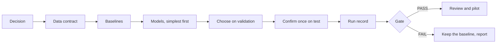

# Methodology: from a decision to a promotion gate

The harness encodes one idea: **the difference between an experiment and a model in operation is not the algorithm, it
is the process** - a clear decision, a data contract, simple baselines, the error that matters and a gate that decides.

## 1. Start from the decision

Write who decides what, how often and with which capacity. "Predict failures" is not a decision; "choose which K assets
to inspect next week" is. The decision fixes the unit (asset-week), the horizon (next week) and the metric (capture@K).

## 2. Write the contract before training

See the [data-contract skill](../.agents/skills/data-contract/SKILL.md) and the
[example contract](../examples/weekly_risk/contract.json). Two fields are routinely forgotten:

- **What a zero means.** Without an exposure or observation flag, "no event" mixes "worked without failure", "was not
  operating" and "was not recorded". The example carries an `observed` column; unobserved weeks are missing in features
  and excluded as targets.
- **Who is scored, and what falls outside.** Choosing the population with future data leaks. Entities that appear later
  are reported as coverage instead of silently dropped.

## 3. Baselines are the bar

A last-period rule, a recent mean, a domain formula. In the [small_data](../examples/small_data/run.py) example, with 16
rows a cost formula that learns a single margin errs about 0.8% and a neural network 10% to 17%, depending on the seed.
In the [weekly_risk](../examples/weekly_risk/run.py) example the bar is the best of three simple rules on test.

## 4. Time flows one way

- Features for period t use periods < t only.
- Splits are temporal: history, then train, then validation (choose), then test (confirm once).
- Ties on validation go to the simpler model.
- Preprocessing is fitted on training rows only.

## 5. The metric follows the decision

`capture_at_k`: in each period, the share of the actual loss that falls on the K entities ranked first. Ties are broken
at random with a fixed seed, so a baseline full of zeros does not get a lucky order. The **oracle** (ranking by the
actual outcome) gives the ceiling. Uncertainty comes from a **block bootstrap** over periods, because neighbouring weeks
look alike.

## 6. Every number has a run record

`mlh.registry.record` stores the hashes of the data, the code and the contract, versions, the git commit, parameters,
results and how many times this contract's test split has been evaluated. Records are never edited by hand.

## 7. The gate

Six rules, thresholds from the contract ([promotion-gate skill](../.agents/skills/promotion-gate/SKILL.md)): improvement
over the best baseline, certainty, ceiling, contract, test budget and freshness. What the example shows:

| Run | Result | Why |
|---|---|---|
| `make demo` | PASS | The model finds real structure in the synthetic world: +4.3 points of capture@20 over the best baseline, 90% interval [+2.3, +6.2] |
| `make demo-leak` | FAIL | A feature known only after the week ends lifts the model to +12.0 points, yet it stays below the ceiling. Only the contract rule catches it |

The second row is the lesson: **the ceiling rule only catches gross leakage**. Subtle leakage is caught by the contract
(allowed features) and by reviewing the diff ([leakage-review skill](../.agents/skills/leakage-review/SKILL.md)).

The synthetic world was designed so that an honest model can win. Real data often says otherwise: a well-defined simple
rule is frequently as good as a model, and then the right next step is better data (exposure, coverage, reliable
labels), not a bigger model.

## 8. After PASS

PASS means the model may move to the next review: the contract and the diff are reviewed (`ml-reviewer` subagent) and a
pilot with users measures whether acting on the ranking helps. A gate never measures business value.
